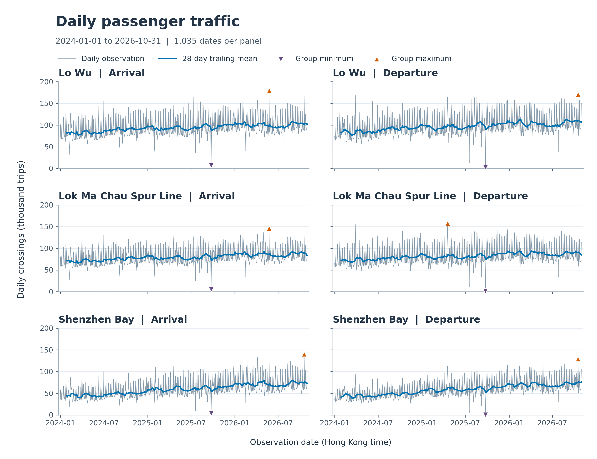
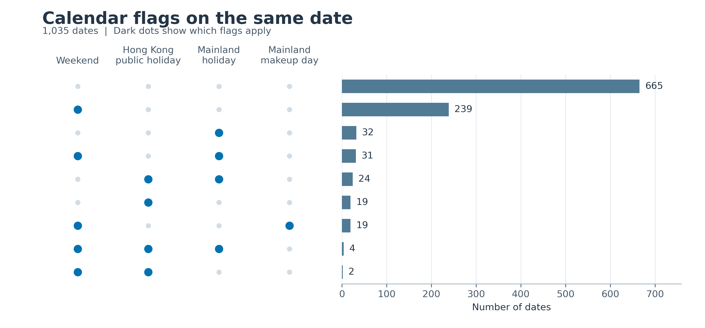
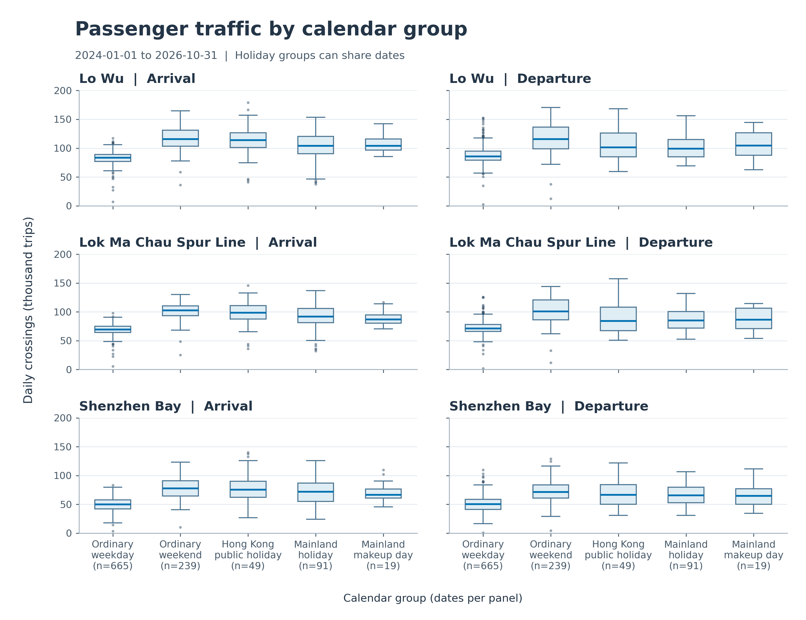

# 三个陆路口岸的逐日客流探索分析

本分析使用 `traffic_calendar.csv` 中已复核的客流与日历字段，覆盖 **2024-01-01 至 2026-10-31**，共 1,035 天、6,210 条记录。罗湖、落马洲支线和深圳湾各分入境香港与出境香港，每组 1,035 天，单位为人次。 [Issue #10](https://github.com/lzndXJ/Statistical_Analysis_and_Modeling_Final_Project/issues/10) · [数据独立复核与交接](../数据核验/分析表独立复核与建模交接.md)

## 1. 六组客流和趋势

| 口岸 | 方向 | 日均人次 | 中位数 | 最低 | 最高 |
| --- | --- | ---: | ---: | ---: | ---: |
| 罗湖 | 入境 | 93,680 | 88,348 | 7,153 | 179,271 |
| 罗湖 | 出境 | 96,490 | 91,296 | 2,741 | 170,603 |
| 落马洲支线 | 入境 | 79,515 | 74,655 | 5,523 | 145,807 |
| 落马洲支线 | 出境 | 81,608 | 76,146 | 2,022 | 157,298 |
| 深圳湾 | 入境 | 59,479 | 55,912 | 3,708 | 140,103 |
| 深圳湾 | 出境 | 58,341 | 55,795 | 881 | 129,011 |

罗湖两个方向的日均人次均居三个口岸之首。选每年都有完整观测的 **1–10 月**比较，六组日均人次从 2024 年到 2026 年逐年上升。其中深圳湾入境由 46,517 升至 71,478，出境由 45,352 升至 70,147。 [六组基本统计](图表/group_summary.csv) · [各年同期统计](图表/matched_year_summary.csv)

图 1。细线为每日实际人次，粗线为截至该日的连续 28 天均值，前 27 天不足一个窗口。向下、向上的三角分别标记该组最低和最高值。六个面板采用相同纵轴，单位为千人次。

## 2. 日期类别的交叠与客流差异

按日期去重后，周一至周五 740 天，周末 295 天。49 个香港公众假期及补假中有 6 天在周末，91 个内地放假日中有 35 天在周末。**两地同时放假 28 天**，其中 4 天也是周末。**19 个内地补班日均在周末**。四个标记在样本中有 9 种组合，合计 1,035 天。 [交叠计数及示例日期](图表/calendar_overlap.csv)

图 2。每行对应一组日历标记，深色大点表示标记为 1，右侧横条显示日期数。例如，只有第一列和最后一列有深色点的一行，表示周末内地补班，共 19 天。

以同口岸同方向的**普通工作日**中位数为基准。普通工作日（665 天）与普通周末（239 天）均排除两地假期和内地补班。另外三组按各自的原标记取样。

- **普通周末**的客流中位数在六组均更高，幅度为 **35.1%–55.1%**。深圳湾入境差幅最大，由普通工作日的 50,192 增至普通周末的 77,850 人次。
- **香港公众假期**比普通工作日高 **17.8%–50.7%**，三个口岸入境的相对增幅均大于同口岸出境。**内地放假**比普通工作日高 **15.4%–43.5%**。
- **内地补班**在六组都介于普通工作日与普通周末之间，较普通工作日高 **21.3%–33.3%**。该组只有 19 天。

比较表还列出按星期几统计的两组、仅香港放假（21 天）、仅内地放假（63 天）和两地同时放假（28 天）。相对差异计算为（比较组中位数 ÷ 同组普通工作日中位数 − 1）× 100%。这些是观测样本的描述性差异，受年份、星期几和假期组合共同影响。 [分日期类别统计](图表/calendar_summary.csv)

图 3。箱内线是中位数，箱体覆盖第 25 至第 75 百分位，须线延到距箱边 1.5 倍四分位距以内的最远观测，散点为须外的实际观测。括号内为每组日期数。两地放假日期允许交叠。

## 3. 回查组内最高和最低值

每组最高、最低值共 12 条。按日期、口岸和方向定位后，香港居民、内地访客、其他访客和总人次均与官方快照逐字段一致。极值表保留快照的日期和方向写法，`raw_line` 从原表表头第 1 行起计。所有极值都纳入统计。 [极值和原始行定位](图表/verified_extremes.csv) · [官方快照](../../data/raw/statistics_on_daily_passenger_traffic.csv.gz)

- **最低值**全部发生在 2025-09-24，六组范围为 881 至 7,153 人次。当天四个日历标记均为 0，香港天文台因超强台风桦加沙发出十号飓风信号。这个事件为共同低值提供了天气背景。 [香港天文台九月天气回顾](https://www.hko.gov.hk/sc/wxinfo/pastwx/mws2025/mws202509.htm)
- **最高值**分布在香港公众假期和普通周六。例如 2026-05-25 香港佛诞补假，罗湖和落马洲支线入境分别录得 179,271 和 145,807 人次。2026-10-17 为普通周六，罗湖和深圳湾分别在当天录得各自的出境最高值。 [假期口径及公告](../../data/README.md#假期与调休)

## 4. 留给后续建模验证的问题

- 验证周末与普通工作日的差异，以及节假日与出入境方向的关系在验证期是否重现。随结果报告两地假期交叠与补班样本数。
- 六组 1–10 月的日均人次都在上升。比较近期已发布客流与上周同日客流各自的预测价值。
- 预测 D 日时，在香港时间 D−1 日 18:00 暂用 D−2 及更早且已发布的客流。回测须说明发布时间与历史修订的证据限制。本次分析使用全期数据提出假设，后续按时间切分进行模型选择、阈值设定和最终评估。 [项目约定](../项目协作/项目约定.md) · [发布时间核验](../数据核验/客流核验说明.md)

- 天气关联试验完成后，将次日显著降雨概率与前一天 18:00 的台风信号加入主表。后续用同一验证期对比有无天气特征的预测效果。 [天气关联结果](天气关联/天气与客流.md) · [两项特征的字段说明](../../data/README.md#天气数据issue-10)

[重跑命令](../../code/README.md#客流探索分析issue-10) · [复现清单](图表/reproduction.json)
